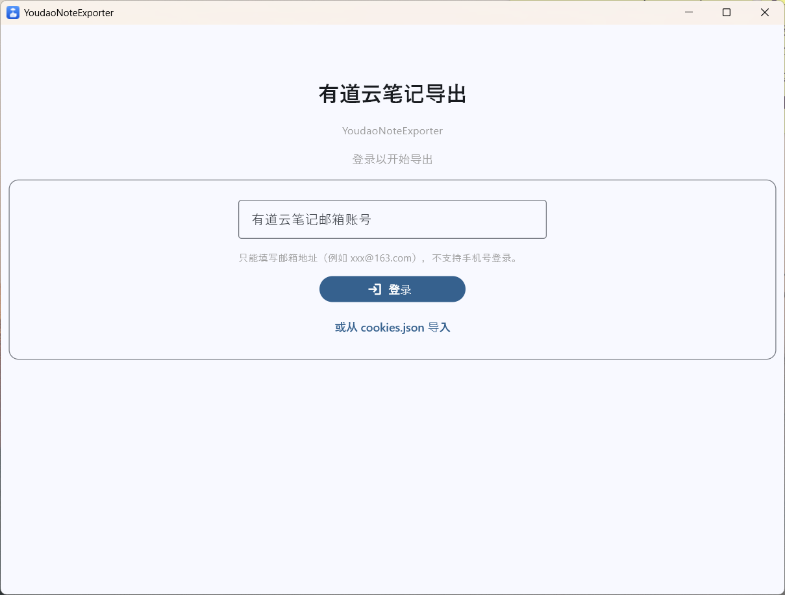
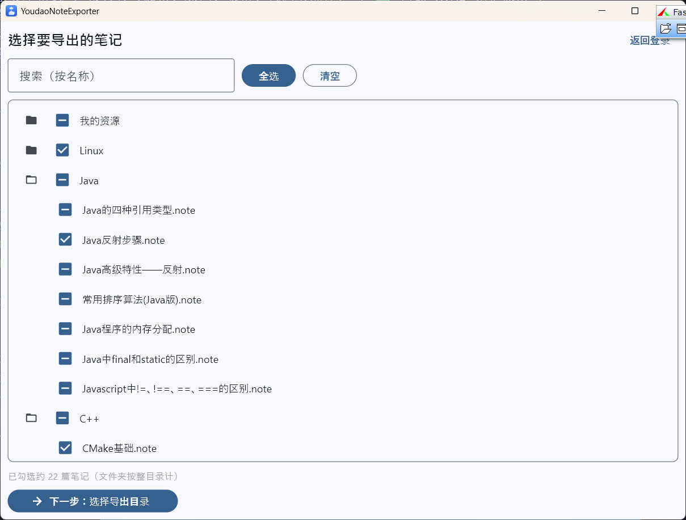
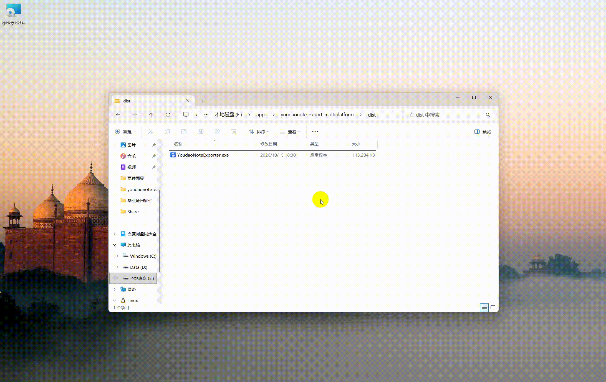

# 有道云笔记批量导出工具 · 图形界面版

**youdaonote-export-multiplatform** —— 一键把有道云笔记**完整**导出为本地 Markdown：图片自动内嵌为 base64、富文本格式原样保留，导出的文件完全自包含，可直接导入 **ima / 语雀 / Notion / Obsidian** 等知识库。


> **和命令行脚本最大的区别：内置图形界面。** 不用敲命令、不用手动按 F12 抓 Cookie、不用装 Python —— 下载 → 登录 → 导出，三步搞定。

---

## 为什么选它

| 能力 | 传统命令行导出脚本 | 本工具 |
| --- | --- | --- |
| 使用方式 | 纯命令行，需手工编辑配置文件 | ✅ 图形界面，点选即可 |
| 获取 Cookie | 手动 F12 复制，步骤繁琐易失效 | ✅ 自动拉起浏览器登录，扫码 / 账号密码 |
| 登录态 | 每次手动粘贴 | ✅ 自动保存，后续免密登录 |
| 富文本格式 | 常丢失（加粗、颜色、表格、代码块乱掉） | ✅ 内嵌 HTML 完整保留 |
| 图片 | 常需自建 / 配置图床 | ✅ 默认 base64 内嵌，单文件自包含 |
| 运行环境 | 必须装 Python 与一堆依赖 | ✅ 打包为可执行文件，免环境 |
| 多账号 | 不支持 | ✅ 账号一致性校验，防串号 |
| 平台 | 通常仅 Windows | ✅ Windows / macOS / Linux |

<!--
  【建议补充截图 —— 这是目前最影响 star 的一点】
  工具类项目没有效果图，访客 3 秒内无法建立信任。请补 3 张图 + 1 个 GIF，
  图片放到仓库 docs/screenshots/ 目录，然后把下面含 img 的代码块取消注释即可：

  1. 登录页        docs/screenshots/login.png
  2. 目录树勾选页   docs/screenshots/tree.png
  3. 导出进度/结果页 docs/screenshots/export.png
  4. 10 秒演示 GIF  docs/screenshots/demo.gif （打开→登录→勾选→导出→打开生成的 .md）

  <p align="center">
    
    
  </p>
  <p align="center"></p>
-->

---

## 下载与安装（推荐普通用户）

到 **[Releases](https://github.com/thinksmart-nicholas/youdaonote-export-multiplatform/releases/latest)** 下载对应平台的现成程序，**无需安装 Python 环境**：

| 平台 | 文件 | 使用方式 |
| --- | --- | --- |
| Windows | `YoudaoNoteExporter-Windows.exe` | 双击运行 |
| macOS | `YoudaoNoteExporter-macOS.zip` | 解压后把 `YoudaoNoteExporter.app` 拖入「应用程序」 |
| Linux | `YoudaoNoteExporter-Linux` | `chmod +x` 后运行 |

**三步上手：**

1. **登录** —— 打开程序点「登录」，在弹出的浏览器里完成有道云笔记登录，Cookie 自动抓取（首次运行会自动下载匹配的浏览器驱动，默认已开启 npmmirror 加速下载，请保持联网）。
2. **选笔记** —— 在目录树里勾选要导出的笔记 / 文件夹（可全选）。
3. **导出** —— 选择本地保存目录，点击导出，完成后到该目录查看 `.md` 文件。

> Releases 中的安装包由仓库内 [`.github/workflows/build.yml`](.github/workflows/build.yml) 自动构建：推送一个 `v*` 标签（例如 `v1.0.0`），三平台产物会自动上传到 Release。

> 想从源码运行、参与开发或自行打包？见下方 [快速开始（源码 / 开发模式）](#快速开始源码--开发模式) 与 [打包为桌面应用](#打包为桌面应用windows--macos--linux)。

---

## 更新日志

> [!CAUTION]
> **近期重大更新。**
>
> 1. **项目名称变更**：项目名称正式改为 **youdaonote-export-multiplatform**（原 youdaonote-to-md），后续文档与发布统一使用新名称。
> 2. **新增图形界面（UI）**：基于 [flet](https://flet.dev) 框架新增了可视化界面，现在用户可以直接通过图形化界面完成登录、选择笔记与导出操作，无需手工编辑配置文件。具体介绍详见「图形界面（GUI）」小节。
> 3. **新增打包功能**：支持将源码打包成独立可执行文件，方便分发；支持 Windows / macOS / Linux 三个平台。其中 **Windows/Linux平台已测试通过**，Mac平台待测，也欢迎用户自行测试并反馈。具体打包方式详见「打包为桌面应用（Windows / macOS / Linux）」小节。
> 4. **重构代码结构**：拆分了原有大文件，并增加了开发模式下的 log 功能。

---

## 功能特性

### 核心功能

- 图形化界面和命令行两套操作方式
- 按原目录结构批量导出所有有道云笔记到本地
- 笔记格式自动转换：XML / JSON / HTML → Markdown
- 增量导出：仅下载新增或修改的笔记，跳过未更新的文件

### 图片处理

- **base64 内嵌模式（默认）**：图片以 `data:image/png;base64,...` 格式嵌入 Markdown，无需外部图片文件
- **本地文件模式**：图片下载到 `images/` 目录，Markdown 中使用相对路径引用
- 有道云笔记图片链接自动下载并替换
- `file:///` 本地绝对路径引用自动清理
- 图片文件名特殊字符自动清理（`(){}[]$~@%` 等），防止 Markdown 链接截断
- 可选上传图片到 SM.MS 图床
- **支持原笔记中富文本格式的导出**：富文本格式以内嵌HTML标签的方式直接加入到导出的Markdown文件中，目前在edge浏览器插件Markdown Viewer Enhanced、语雀和Typroa上测试通过。

### 兼容性

- 兼容 Python 3.9+（已在 3.13 上验证通过）
- 兼容 Windows / macOS / Linux
- 修复 Windows 下 `os.rename` 目标已存在导致 `.note` 残留的问题

## 前置条件

从源码运行或自行打包，本机需要先具备 **Python 3.9+** 与 **pip**。
普通用户直接下载 [Releases](https://github.com/thinksmart-nicholas/youdaonote-export-multiplatform/releases/latest) 里的现成程序即可，无需任何环境。

### 1. 安装 Python 3.9+

| 平台 | 安装命令 |
| --- | --- |
| Windows | 到 [python.org](https://www.python.org/downloads/windows/) 下载安装包，**安装时务必勾选 `Add python.exe to PATH`**（否则命令行找不到 `python` / `pip`） |
| macOS | `brew install python`（Homebrew）或 python.org 官方安装包 |
| Linux（Debian / Ubuntu） | `sudo apt install python3 python3-venv` |
| Linux（Fedora） | `sudo dnf install python3 python3-pip` |
| Linux（Arch） | `sudo pacman -S python` |

> 提示：Debian/Ubuntu 需带 `python3-venv` 才能创建虚拟环境，详见下方「创建虚拟环境」。

安装后验证：

```shell
python3 --version    # Windows 上为 python --version，应输出 3.9+
```

### 2. 安装 pip

Python 3.4+ 的官方安装包已自带 pip；若因精简安装或发行版拆分导致 `pip` 命令不可用，按平台补装：

```shell
# Windows：Python 自带 pip，缺失时用 ensurepip 修复
python -m ensurepip --upgrade
```

```shell
# macOS（Homebrew 的 python 自带 pip；缺失时）
python3 -m ensurepip --upgrade
```

```shell
# Linux
# Debian / Ubuntu：
sudo apt install python3-pip
# Fedora：
sudo dnf install python3-pip
# Arch（python 包已含 pip；缺失时）：
sudo pacman -S python-pip
```

验证 pip 可用：

```shell
pip3 --version       # Windows 上为 pip --version
```

## 创建虚拟环境

后续统一用虚拟环境隔离依赖，避免污染系统 Python。请在**项目源码根目录**（即包含 `requirements.txt` 的那一层）下创建并激活 venv：

```shell
# 先进入源码根目录
cd youdaonote-export-multiplatform

# Windows
python -m venv venv
venv\Scripts\activate

# macOS / Linux
python3 -m venv venv
source venv/bin/activate
```

激活成功后，命令行提示符前会出现 `(venv)`，表示后续 `pip` 安装都只作用于该环境。

> **Ubuntu / Debian 创建虚拟环境报错 `ensurepip is not available`？**
> 执行 `python3 -m venv venv` 若提示 *"The virtual environment was not created
> successfully because ensurepip is not available"*，是因为 Debian/Ubuntu 把 `venv`
> 拆成了独立包，最小化安装没带 `python3-venv`。解决办法就是补装它：
> ```shell
> sudo apt install python3-venv
> ```
> 装好后重新 `python3 -m venv venv` 即可。
>
> **macOS 是否有同样问题？** 一般没有。Homebrew 的 `python`（`brew install python`）
> 与 python.org 官方安装包都自带 `ensurepip` 和 `venv`，`python3 -m venv venv` 开箱即用。
> 只有用了被裁剪过的 Python 才可能缺 `ensurepip`，此时用 `python3 -m ensurepip --upgrade`
> 即可修复（见上方「安装 pip」）。

## 快速开始（源码 / 开发模式）

### 1. 安装依赖

需要 Python 3.9+（推荐 3.11+）。已按上方「创建虚拟环境」创建并激活 venv 后，安装依赖：

```shell
# Windows（已激活 venv）
pip install -r requirements.txt
```

```shell
# macOS / Linux（已激活 venv）
pip3 install -r requirements.txt
```

依赖列表（`requirements.txt`）：

| 依赖 | 版本要求 | 用途 |
|------|----------|------|
| flet | ==1.0.4 | 图形界面（GUI）核心库；其自带的 `flet` 命令即打包用的 CLI |
| flet-desktop | ==1.0.4 | 桌面客户端（flet 核心包不含）。`flet run` 与 `flet pack` 都需要 |
| selenium | >=4.11 | 网页登录抓取 Cookie（GUI 登录页使用） |
| requests | >=2.32.0 | HTTP 请求（兼容 Python 3.13） |
| markdownify | ==0.5.1 | HTML 转 Markdown |
| Brotli | >=1.1.0 | 解压响应（兼容 Python 3.13） |
| win32-setctime | ==1.1.0 | Windows 下设置文件创建时间 |

### 2. 获取有道云笔记 Cookie

由于有道云笔记登录升级了图形验证码，脚本使用 Cookie 登录。

1. 在浏览器中登录 [有道云笔记](https://note.youdao.com)
2. 按 `F12` 打开开发者工具 → Network 面板
3. 找到任意请求，复制 Cookie 中的以下三个值：
   - `YNOTE_CSTK`
   - `YNOTE_LOGIN`
   - `YNOTE_SESS`

> 也可安装浏览器插件 [Cookie-copy](https://chromewebstore.google.com/detail/cookie-copy/igfcbpdchlohbhjdfbcimhbpajlglaac) 快速复制。

### 3. 配置 cookies.json

将获取的 Cookie 填入 `cookies.json`：

```json
{
    "cookies": [
        ["YNOTE_CSTK", "你的CSTK值", ".note.youdao.com", "/"],
        ["YNOTE_LOGIN", "你的LOGIN值", ".note.youdao.com", "/"],
        ["YNOTE_SESS", "你的SESS值", ".note.youdao.com", "/"]
    ]
}
```

### 4. 配置 config.json

```json
{
    "local_dir": "",
    "ydnote_dir": "",
    "smms_secret_token": "",
    "is_relative_path": true,
    "is_base64_image": true
}
```

配置项说明：

| 参数 | 类型 | 说明 | 默认值 |
|------|------|------|--------|
| `local_dir` | string | 本地存放导出文件的绝对路径，留空则导出到脚本目录下的 `youdaonote/` | `""` |
| `ydnote_dir` | string | 指定导出的有道云笔记目录，留空则导出所有笔记。支持多级路径，用 `/` 分隔（也兼容 `\`），如 `工作/2026/项目A` | `""` |
| `smms_secret_token` | string | SM.MS 图床 Token，留空则不上传 | `""` |
| `is_relative_path` | bool | 附件是否使用相对路径（base64 模式下图片不受影响） | `true` |
| `is_base64_image` | bool | 是否将图片以 base64 内嵌到 Markdown 中 | `true` |

### 5. 运行导出

```shell
# 激活虚拟环境后
python pull.py    # Windows
python3 pull.py   # macOS / Linux
```

导出完成后，所有笔记保存在 `youdaonote/` 目录下（或你指定的 `local_dir`）。

### 6. 增量导出

再次运行同一命令即可。脚本根据笔记修改时间判断是否需要更新，仅下载新增或修改的笔记，不会覆盖本地已修改的文件。

### 7. 查看云端笔记列表（可选）

导出前想先确认云端有哪些笔记，或导出后想核对是否有遗漏，可以只拉取元信息、不下载笔记内容：

```shell
python tools/list_notes.py              # 打印整棵目录树
python tools/list_notes.py 工作/2026     # 只看指定子目录（支持多级，兼容 \ 分隔）
python tools/list_notes.py --flat       # 额外输出「id / 名称 / 创建时间 / 修改时间」扁平清单
```

- 只读操作，不会写入 `youdaonote/`
- 也是快速验证 Cookie 是否有效的手段：若提示 `AUTHENTICATION_FAILURE`，说明 Cookie 已过期，需重新获取
- 注意 `get_dir_info_by_id` 的 `len=1000` 是写死的，单个文件夹条目超过 1000 条会被截断（脚本未做分页）

## 图形界面（GUI）

除命令行 `pull.py` 外，项目还提供了基于 [flet](https://flet.dev) 的图形界面（`ui/main.py`）。
无需手工编辑 `cookies.json` 与 `config.json`，按界面引导即可完成导出。

### 1. 开发模式下启动界面

在项目根目录执行：

```shell
flet run ui/main.py
```

> 无需 Flutter SDK，flet 自带预编译桌面客户端；首次运行会准备客户端（一次性操作）。
> 若要分发给别人使用，请用 `build.py` 打包，详见「打包为桌面应用（Windows / macOS / Linux）」。

### 2. 三种登录方式

登录页只需填写**有道云笔记邮箱账号**（不支持手机号），程序会自动判断走哪条路径：

| 场景 | 行为 |
|------|------|
| **首次登录 / Cookie 已过期** | 本地没有该账号记录，或已保存的 Cookie 失效 → 自动转入网页登录 |
| **非首次登录** | 本地已存有有效 Cookie → 直接登录成功，无需任何额外操作 |
| **从 cookies.json 导入** | 点击「或从 cookies.json 导入」，选择命令行同样使用的 `cookies.json` 复用凭据 |

### 3. 首次登录：自动装驱动并打开浏览器

首次登录（或 Cookie 已过期）时，程序会自动完成以下动作：

1. **检测浏览器**：自动探测系统中已安装的 Microsoft Edge / Google Chrome / Firefox
2. **下载驱动**：自动下载与该浏览器版本匹配的驱动程序（默认走 npmmirror 镜像加速），
   缓存到 `~/.cache/selenium`，**只下载一次**，之后复用
3. **打开网页**：调用该浏览器打开有道云笔记网页版（`https://note.youdao.com/web/`），
   供你手动完成登录

你在浏览器中登录成功后，程序会自动提取 `YNOTE_CSTK` / `YNOTE_LOGIN` / `YNOTE_SESS` 三个 Cookie
并关闭浏览器，无需手动复制任何内容。

> 若三种浏览器都没安装，会提示失败；此时可改用「从 cookies.json 导入」。
> 驱动下载与镜像加速详见「浏览器驱动与下载加速」。

### 4. 登录态自动保存，后续免密登录

首次登录成功后，Cookie 会按**浏览器实际登录的账号**写入本地数据库 `accounts.db`（SQLite，
位于可执行文件所在目录，详见「运行打包后的程序」）。

以后再使用时，只需输入正确的云笔记邮箱账号，即可**自动登录**，不必重复网页登录。

> `accounts.db` 保存的是真实登录凭据，请勿外传；仓库中已被 `.gitignore` 排除。

### 5. 账号一致性校验（防止越权查看）

登录时会通过接口读取 Cookie 对应的**真实账号**，与你输入的邮箱账号比对，**不一致则阻止登录**：

- **从 cookies.json 导入时**：若两者不一致，直接阻止导入，并提示
  「你输入的账号「X」与该 cookies 对应的账号「Y」不一致」
- **网页登录时**：按浏览器中**实际登录**的账号保存，而不是你输入的账号，
  从源头上避免账号错位

这一校验可避免利用他人 Cookie 查看他人云笔记的情况发生。

### 6. 笔记目录树与导出目录选择

登录后展示云端笔记的**目录树**：

- 可勾选**单篇笔记**，也可勾选**整个文件夹**（其下所有笔记都会被导出）
- 支持展开 / 收起，按需选择要导出的内容
- 点击「选择目录」可自由指定**导出保存位置**（不使用默认目录，完全由你决定）

### 7. 增量导出

与命令行一致，GUI 同样支持增量导出：只处理**未导出过**或**内容已更新**的笔记，
未发生变化的笔记自动跳过，显著节省时间。

### 8. 实时进度与统计

导出过程中实时显示：

- 进度条，以及「(已完成/总数) 当前笔记名」
- 逐条日志，用 `导出：` / `更新：` / `跳过：` 区分每条笔记的处理结果
- 可随时点击「取消导出」中断（导出中关闭窗口也会触发取消）
- 完成后给出统计：**新增 X，更新 Y，跳过 Z，失败 N**，并列出失败笔记的明细

## 导出模式对比

### base64 内嵌模式（推荐，默认启用）

图片直接以 `data:image/png;base64,...` 格式嵌入 Markdown 文本中。

**适用场景**：导入 ima、Notion 等云端知识库

**优点**：
- 每个 Markdown 文件完全自包含，不依赖外部图片文件
- 导入云端知识库后图片正常显示
- 不生成 `images/` 目录，目录结构更简洁

**缺点**：
- 文件体积增大约 33%（base64 编码开销）
- 含大量图片的单个 Markdown 文件可能较大

### 本地文件模式（`is_base64_image: false`）

图片下载到各目录下的 `images/` 文件夹，Markdown 中使用相对路径引用。

**适用场景**：使用 Typora、VS Code 等本地编辑器查看

**优点**：
- 文件体积小
- 本地编辑器预览正常

**缺点**：
- 导入云端知识库时图片无法显示（图片不会上传）

## 项目结构

```
youdaonote-export-multiplatform/
├── pull.py                  # 命令行主脚本入口
├── build.py                 # 打包脚本（flet pack / PyInstaller → 各平台桌面可执行程序）
├── config.json              # 导出配置（含 Token，已被 .gitignore 排除）
├── config.example.json      # 配置样例模板
├── cookies.json             # 有道云笔记 Cookie（敏感信息，已被 .gitignore 排除）
├── accounts.db              # GUI 账户 Cookie 本地库（SQLite，敏感信息，已被 .gitignore 排除）
├── requirements.txt         # Python 运行时依赖（需 Python >= 3.9）
├── requirements-build.txt   # 打包专用依赖（= requirements.txt + 锁定版 PyInstaller）
├── LICENSE                  # MIT 许可证
├── .gitignore               # 排除 Cookie / 账户库 / 配置 / 导出目录 / 日志 / 打包产物等
├── .gitattributes           # Git 换行符与文件属性配置
├── .github/                 # GitHub Actions 工作流（三平台自动打包）
│   └── workflows/
│       └── build.yml        # 推 tag / 手动触发：出 Windows / macOS / Linux 安装包并挂到 Release
├── README.md                # 项目说明
├── YoudaoNoteExporter.spec    # PyInstaller 打包配置（自动生成，已被 .gitignore 排除）
├── ui/                      # 图形界面（flet），入口 ui/main.py
│   ├── main.py              # GUI 入口：窗口配置与页面路由（login → tree → export）
│   ├── login_view.py        # 登录页：cookies.json 导入 + Selenium 网页登录（含驱动镜像加速）
│   ├── tree_view.py         # 云端笔记目录树：勾选要导出的笔记 / 文件夹
│   ├── export_view.py       # 导出页：选择目标目录、进度显示、取消导出
│   └── db.py                # 账户 Cookie 本地持久化（SQLite accounts.db）
├── core/                    # 核心模块
│   ├── api.py               # 有道云笔记 API 封装（登录、获取目录、下载文件）
│   ├── exporter.py          # 导出引擎：登录 / 目录树 / 导出 / 进度回调（CLI 与 GUI 共用）
│   ├── covert/              # 笔记格式转换包（XML/JSON/HTML → Markdown）
│   │   ├── __init__.py      # 门面：导出 YoudaoNoteConvert / XmlElementConvert / JsonConvert
│   │   ├── convert.py       # 三个转换入口（HTML / XML / JSON → Markdown）
│   │   ├── xml_convert.py   # XML 格式 note 的标签转换规则
│   │   ├── json_convert.py  # JSON 格式 note 的字段转换规则（含白板扩展类型）
│   │   ├── indent.py        # 缩进还原（原生缩进字段 + 启发式层级恢复）
│   │   ├── postprocess.py   # Markdown 生成后的统一后处理链
│   │   ├── style.py         # 共享样式工具（span 扁平化、颜色规范化）
│   │   └── util.py          # 公共常量与小工具
│   ├── image.py             # 图片/附件处理（base64 内嵌、本地下载、文件名清理）
│   ├── whiteboard_render.py # 白板渲染（excalidraw / drawio-ynote / mindmap → SVG）
│   ├── common.py            # 通用工具函数（项目根目录定位）
│   └── log.py               # 日志配置（输出到文件和终端）
├── tools/                   # 维护工具
│   ├── install-linux.sh     # Linux 安装脚本（可执行文件 / .desktop / 图标 → 标准位置）
│   ├── list_notes.py        # 列出云端笔记目录树（只读元信息，不下载内容）
│   ├── make_baseline.py     # golden 基线工具（校验转换输出是否变化）
│   ├── dump_login_headers.py    # 登录请求头抓取（排查用）
│   ├── probe_user_endpoints.py  # 用户信息接口探测（排查用）
│   └── baseline/            # 基线输出（自动生成，已被 .gitignore 排除）
├── test/                    # 测试脚本与样本
│   ├── test.py              # 单元测试
│   ├── test_whiteboard_render.py     # 白板渲染测试（72 项）
│   ├── test_whiteboard_covert.py     # 白板转换测试（42 项）
│   ├── test_whiteboard_regression.py # 回归测试：白板接入不影响既有转换流程
│   ├── probe_whiteboard_render.py    # 白板渲染探测脚本
│   ├── test.note            # XML 格式笔记样本（合成数据）
│   ├── test.json            # JSON 格式笔记样本（合成数据）
│   ├── test-convert.json    # JSON 转换样本（合成数据）
│   ├── Zygote进程的作用.note  # 白板端到端样本（资源 URL 已脱敏为 example.com）
│   └── whiteboard_samples/  # 白板二进制资源样本
├── other/                   # 打包图标资源（icon.ico / icon.icns / icon.png 及 Linux 用的 icons/hicolor 多尺寸图标树）
├── logs/                    # 运行日志（自动生成）
└── youdaonote/              # 导出目录（自动生成，已被 .gitignore 排除）
```

说明：

- 项目有两套入口：命令行 `pull.py`（见「快速开始」）与图形界面 `ui/main.py`（flet）。
  开发时直接运行 GUI：在项目根目录执行 `flet run ui/main.py`（无需 Flutter SDK，flet 自带预编译桌面客户端）；
  分发给用户则用 `build.py` 打包，详见「打包为桌面应用（Windows / macOS / Linux）」。
- `core/covert/` 由原先 2900+ 行的单文件 `covert.py` 拆分而来，`__init__.py` 作为稳定门面，
  保持 `from core.covert import YoudaoNoteConvert` 等既有导入方式不变。
- 改动转换逻辑后，可用 golden 基线校验输出是否变化（当前覆盖 4 个样本，含 XML / JSON 路径）：

```shell
python tools/make_baseline.py            # 重新采集基线（改动前执行）
python tools/make_baseline.py --compare  # 与基线逐字节比对（改动后执行）
```

## 导出后目录结构示例

```
youdaonote/
├── 笔记文件夹1/
│   ├── 笔记A.md              # base64 图片内嵌在文件中
│   ├── 笔记B.md
│   └── 子文件夹/
│       └── 笔记C.md
├── 笔记文件夹2/
│   ├── 笔记D.md
│   └── attachments/          # 附件目录（仅当笔记包含附件时生成）
│       └── document.pdf
└── 根目录笔记.md
```

## 打包为桌面应用（Windows / macOS / Linux）

除命令行 `pull.py` 外，项目还提供了基于 flet 的图形界面（`ui/main.py`）。
用 `build.py`（封装 `flet pack`，底层是 PyInstaller）可将其打包成各平台的独立可执行程序，
目标机器无需安装 Python。

### 安装打包依赖

> Python 与 pip 的安装见上方「前置条件」；虚拟环境的**创建与激活见上方「创建虚拟环境」**，
> 无需重建——`requirements-build.txt` 已内含 `requirements.txt`，在同一个已激活的 venv 里
> 直接补装打包依赖即可：

```shell
# Windows（已激活 venv）
pip install -r requirements-build.txt
```

```shell
# macOS / Linux（已激活 venv）
pip3 install -r requirements-build.txt
```

  > **PyInstaller 是构建期依赖**，因此放在单独的 `requirements-build.txt`，不污染运行时依赖：
  > 只想运行源码 / GUI 的用户装 `requirements.txt` 即可。
  > 未安装时 `flet pack` 会报 `Please install PyInstaller module to use flet pack command`。
  > Windows 下 PyInstaller 会自动带上 `pefile`、`pywin32-ctypes`，macOS 带 `macholib`，
  > 无需额外处理；启用自定义图标时 `flet pack` 会用到其中的 `pefile`。

> **必须在目标平台本机打包**：Windows 打 exe、macOS 打 `.app`、Linux 打可执行文件。
> `build.py` 已内置 `--collect-data selenium`，会把对应平台的 `selenium-manager` 二进制一并打进包；
> 跨平台打包可能导致该二进制缺少可执行权限，进而使浏览器驱动下载失败。

### 通用打包命令

```shell
python build.py                 # 打包为单文件可执行程序（默认）
python build.py --onedir        # 单目录模式（仅 Windows 有效，便于排查依赖问题）
python build.py --distpath out  # 指定产物输出目录（默认 ./dist）
```

产物默认输出到 `dist/`：

| 平台 | 产物 |
|------|------|
| Windows | `dist/YoudaoNoteExporter.exe` |
| macOS | `dist/YoudaoNoteExporter.app` |
| Linux | `dist/YoudaoNoteExporter`（可执行文件） |

### Windows

1. 安装 Python 3.9+（安装时勾选 "Add python.exe to PATH"）
2. 按上文创建虚拟环境并安装依赖
3. 执行打包：`python build.py`
4. 双击 `dist\YoudaoNoteExporter.exe` 运行
5. 自定义程序图标：把图标放到 `other\icon.ico` 后重新打包
   （`build.py` 检测到文件存在才会自动带上，否则使用默认图标）

> 首次运行需联网下载浏览器驱动，见下方「浏览器驱动与下载加速」。
> 若被杀毒软件误报，可改用 `python build.py --onedir` 生成单目录版本并加入白名单。

### macOS

1. 安装 Python 3.9+（`brew install python` 或官网安装包）
2. 创建虚拟环境并安装依赖
3. 执行打包：`python3 build.py`，产物为 `dist/YoudaoNoteExporter.app`
4. 自定义程序图标：放到 `other/icon.icns` 后重新打包
5. Apple Silicon（M1/M2/M3）请在 arm64 环境的 Python 下打包，否则产物会以 Rosetta 转译运行

### 关于 macOS 未签名 / 未公证

本项目的打包产物**未做代码签名，也未提交 Apple 公证（Notarization）**。完整签名需要付费的
Apple Developer 账号（`codesign --sign` + `notarytool submit`），因此当前分发的 `.app` 在
首次打开时会被 Gatekeeper 拦截。两种解除方式：

**方式一：右键打开（适合本地打包产物）**

1. 在「访达（Finder）」里找到 `YoudaoNoteExporter.app`，**不要双击**，而是**右键（或按住 Control 单击）**
2. 在弹出菜单中选择「打开」
3. 系统会弹出「无法验证开发者」的警告，点击「打开」即可
4. 之后该 app 已被记录为可信，后续双击即可正常启动

若右键菜单没有「打开」项，也可走系统设置：苹果菜单 →「系统设置 → 隐私与安全性」，
在「安全性」区域会出现本次拦截记录，点击「仍要打开」。

**方式二：移除 quarantine 属性（适合从 Release 下载的压缩包）**

从浏览器下载并解压的 `.app` 会被打上 quarantine 标记（`com.apple.quarantine`），
右键打开也常被拦。在终端执行以下命令清除该标记即可正常打开：

```shell
# 解压后进入 app 所在目录
xattr -cr YoudaoNoteExporter.app
# 若仍提示已损坏，可再显式删除 quarantine 属性：
sudo xattr -rd com.apple.quarantine YoudaoNoteExporter.app
```

> 说明：以上只是解除系统拦截，并不改变"未签名"的本质。若要彻底免提示，需自行用
> Apple Developer 证书签名并公证（不在本项目的自动构建范围内）。

### Linux

1. 安装 Python 3.9+ 与 venv 模块（Debian/Ubuntu：`sudo apt install python3 python3-venv`）
2. 创建虚拟环境并安装依赖
3. 执行打包：`python3 build.py`，产物为 `dist/YoudaoNoteExporter`
4. 赋予可执行权限并运行：

```shell
chmod +x dist/YoudaoNoteExporter
./dist/YoudaoNoteExporter
```

5. 自定义图标：Linux 只识别 `.png`，放到 `other/icon.png` 后重新打包。
   打包时 `build.py` 会在 `dist/` 下自动生成 `YoudaoNoteExporter.desktop` 启动器
   （含图标、分类等元数据），已随产物交付；把它和可执行文件放在同一目录，
   即可在桌面环境添加到启动器 / 程序菜单。

### 在 Linux 上安装（图标与启动器）

**只构建、不安装的话，图标不会显示**——这是 Linux 图标机制与 Windows/macOS 的根本差异：

| 差异点 | Windows / macOS | Linux |
| --- | --- | --- |
| 图标存放 | 嵌进 exe / `.app` | **不嵌进可执行文件**，单独放在 hicolor 主题目录 |
| `.desktop` 的 `Icon=` | — | 写的是**图标名**，桌面环境只从主题目录按尺寸查取 |
| `.desktop` 生效位置 | — | 只扫描 `applications/` 目录，放在程序旁边**不会被扫到** |

所以 `dist/` 里的产物直接双击能跑，但**图标是占位图、也不会出现在应用菜单**。
要让图标正常显示并出现在菜单，需要把三者分别装到标准位置。

#### 方式一：用安装脚本（推荐）

```shell
python3 build.py                  # 先构建
bash tools/install-linux.sh       # 默认取 ./dist，装到 ~/.local（无需 root）
```

脚本会把三样东西装到正确位置：可执行文件 → `~/.local/bin/`、
`.desktop` → `~/.local/share/applications/`、图标 → `~/.local/share/icons/hicolor/`，
并刷新图标缓存与 desktop 数据库。之后即可在应用菜单看到带图标的 YoudaoNoteExporter。

```shell
# 其它用法
sudo PREFIX=/usr/local bash tools/install-linux.sh   # 系统级安装（所有用户）
bash tools/install-linux.sh /path/to/dist            # 指定产物目录
bash tools/install-linux.sh --uninstall              # 卸载
```

#### 方式二：从 Release 产物一键安装（推荐手动安装）

从 Release 下载以下 4 个文件，放到**同一个目录**，然后在该目录执行安装脚本：

- `YoudaoNoteExporter-Linux`   （可执行程序）
- `YoudaoNoteExporter.desktop` （启动器）
- `icons-hicolor.tar.gz`       （hicolor 多尺寸图标树）
- `install.sh`                 （官方安装脚本，本身也是 Release 产物）

```shell
bash install.sh
```

脚本会自动完成：把可执行文件装到 `~/.local/bin/`、把图标装进 hicolor 主题
（经 `xdg-icon-resource`，自动建 `index.theme` 并刷新缓存）、把启动器装到
`~/.local/share/applications/` 并把 `Exec` / `Icon` 改写为本机绝对路径、最后刷新启动器数据库。
安装完成后若应用菜单未立即出现，注销重新登录即可。

> 说明：
> - 脚本默认按**当前用户**安装（路径在 `~/.local`）。`install.sh` 与上面三件套一起作为
>   Release 产物发布；它和 `tools/install-linux.sh`（从本地 `dist/` 构建产物安装）用途不同。
> - 系统级（所有用户）安装请手动修改`install.sh`脚本，把路径换到 `/usr/local` 并加 `sudo`。

> 图标源文件与生成脚本见 `other/`：`other/icon.png`（1024 源图）、
> `other/icons/hicolor/`（各尺寸）、`other/make_icon.py`（重新生成）。

> **关于 Dock 图标**
>
> 装好上面的启动器后，**应用菜单**里的图标会正常显示。但运行中的窗口要在 Dock / 任务栏
> 也显示图标，靠的是 `.desktop` 的 `StartupWMClass` 与窗口真实身份匹配；同时 `.desktop` 的
> `Icon=` 必须能按图标名查到已安装图标——若只拷了 `.desktop` 却没把图标装进 hicolor 主题
> （缺 `index.theme` / 缓存未刷新），Dock 仍会回退成默认图标，请用「方式二」的 `xdg-icon-resource` 方式安装。
>
> 注意：flet 的预编译桌面客户端把应用 ID 固化为 `com.appveyor.flet`，GTK 据此派生
> X11 的 `WM_CLASS` 与 Wayland 的 `app_id`；实测设置 `FLET_APP_ID` 环境变量**并不能**
> 改变它（客户端在内部覆盖了 `prgname`）。因此 `build.py` 里 `StartupWMClass` 直接写这个
> 真实值（常量 `WM_CLASS`），Dock / 任务栏才能把窗口关联到本条目、显示正确图标。
>
> 核对实际值：
>
> ```shell
> # X11 会话
> xprop -name "YoudaoNoteExporter" WM_CLASS
> # Wayland 会话（xprop 对 Wayland 窗口无效，改用这个）
> ./YoudaoNoteExporter 2>&1 | head    # 看 GLib 告警前缀 **(xxx:PID): WARNING **
> ```
>
> 若 flet 将来改变了这个固化值，构建时覆盖即可，无需改代码：
> `YOUDAO_WM_CLASS=<新值> python3 build.py`
>
> 另外：GNOME 本来就不在标题栏显示应用图标（只显示窗口标题文字），这是设计如此；
> KDE / XFCE / MATE 才会在标题栏显示图标。

> **Linux 运行时依赖（GTK3 等系统库）**
>
> flet 桌面版基于 Flutter，运行需要 GTK3 等系统库（由操作系统提供，**不打包进二进制**）。
> 这些库在**已安装桌面环境的 Linux 上通常已自带**（GNOME / XFCE / Cinnamon / MATE 等都依赖 GTK3），
> 一般无需额外操作。仅当在**无桌面的精简系统**上运行时，才需要手动补齐：
>
> | 发行版 | 安装命令 |
> | --- | --- |
> | Debian / Ubuntu / Mint | `sudo apt install -y libgtk-3-0 libgthread-3-0 libnotify4` |
> | Fedora / RHEL / CentOS | `sudo dnf install -y gtk3 glib2 libnotify` |
> | Arch / Manjaro | `sudo pacman -S gtk3 glib2 libnotify` |
> | openSUSE | `sudo zypper install -y gtk3 glib2 libnotify` |
>
> 说明：
> - 核心三件套 `gtk3 / glib2 / libnotify` 在所有主流桌面发行版中名字稳定、均可用。
> - 旧的 `libgconf-2-4`（GConf）已被 `GSettings/dconf` 取代，现代 flet 不再依赖；
>   Fedora 36+、Arch 等已移除此包，故未列入上表。若启动罕见报错提示缺少 `libgconf`，
>   再按对应发行版的额外源补装即可。
> - **Alpine 及 musl 系发行版暂不兼容**：flet 二进制基于 glibc 构建，musl 环境下无法运行。
> - 若启动提示缺少 `.so`，按上表用包管理器安装对应运行时即可。

### 运行打包后的程序

**建议先新建一个专用文件夹，把可执行文件放进去再运行**，不要直接双击 `dist` 里的产物，
也不要把 exe 丢在桌面或 `C:\Program Files\` 这类系统目录。

原因是程序会在**可执行文件所在目录**生成运行时数据文件：

| 文件 / 目录 | 说明 |
|-------------|------|
| `accounts.db` | SQLite 数据库，保存登录 Cookie（`YNOTE_CSTK` / `YNOTE_LOGIN` / `YNOTE_SESS`） |
| `logs/` | 运行日志（`pull-年月日-时分秒.log`） |

把这些文件和 exe 放在同一个独立目录里，备份、迁移、整体删除卸载都更方便。

```shell
# Windows：新建目录 → 移入 → 运行
mkdir D:\Tools\YoudaoNoteExporter
move dist\YoudaoNoteExporter.exe D:\Tools\YoudaoNoteExporter\
D:\Tools\YoudaoNoteExporter\YoudaoNoteExporter.exe
```

```shell
# macOS
mkdir -p ~/Applications/YoudaoNoteExporter
cp -R dist/YoudaoNoteExporter.app ~/Applications/YoudaoNoteExporter/
open ~/Applications/YoudaoNoteExporter/YoudaoNoteExporter.app
```

```shell
# Linux
mkdir -p ~/opt/youdaonote-export
cp dist/YoudaoNoteExporter ~/opt/youdaonote-export/
chmod +x ~/opt/youdaonote-export/YoudaoNoteExporter
~/opt/youdaonote-export/YoudaoNoteExporter
```

> **注意事项**
>
> - `accounts.db` 含**真实登录凭据**，请勿外传；仓库中它已被 `.gitignore` 排除。
>   换机器或卸载时，直接删除整个目录即可清除登录态。
> - 若 exe 所在目录**不可写**（例如放在 `C:\Program Files\`），程序会自动改用用户数据目录：
>   Windows `%APPDATA%\youdaonote-export-multiplatform`、macOS `~/Library/Application Support/youdaonote-export-multiplatform`、
>   Linux `~/.local/share/youdaonote-export-multiplatform`。
> - 想显式指定数据目录，可设置环境变量 `YOUDAONOTE_DATA_DIR`（便携部署时很有用）：
>
>   ```shell
>   set YOUDAONOTE_DATA_DIR=D:\Tools\YoudaoNoteExporter\data      # Windows cmd
>   $env:YOUDAONOTE_DATA_DIR="D:\Tools\YoudaoNoteExporter\data"   # Windows PowerShell
>   export YOUDAONOTE_DATA_DIR=~/opt/youdaonote-export/data     # macOS / Linux
>   ```
>
> - 首次运行会联网下载浏览器驱动并缓存到 `~/.cache/selenium`，详见下一节。

### 浏览器驱动与下载加速

GUI 登录页通过 Selenium 打开真实浏览器完成登录，因此**目标机器需安装 Microsoft Edge / Google Chrome / Firefox 之一**。

- 对应驱动由 Selenium Manager 首次运行时联网下载，缓存到 `~/.cache/selenium`，**只下载一次**并复用
- **默认已开启 npmmirror 镜像加速**（Edge / Chrome），一般无需任何配置
- 关闭加速、回退官方源：设置环境变量 `YOUDAO_DRIVER_MIRROR=off`
- 使用自定义镜像：`YOUDAO_DRIVER_MIRROR=<镜像根地址>`
- Firefox 的 geckodriver 在 npmmirror 上只有 `.zip`（Selenium Manager 默认请求 `.tar.gz`），
  故 Firefox **不走镜像**、回退官方源
- Chrome 仅在 npmmirror 已镜像该 Chrome 版本时才走加速；若某版本缺失会下载失败，
  此时可用 `YOUDAO_DRIVER_MIRROR=off` 回退官方源

### 打包常见问题

- **`FileNotFoundError: [Errno 2] No such file or directory: 'flet'`**：
  运行 `build.py` 时找不到 flet 命令行。flet 命令由 `flet` 包自身提供
  （入口点 `flet = flet.cli:main`），报这个错通常说明**脚本不在当前 PATH**：

  1. 是否激活了安装依赖的虚拟环境：`source venv/bin/activate`
  2. 运行 `build.py` 的 `python3` 与安装依赖的 `pip3` 是否是同一个环境
  3. 依赖是否装全：打包用 `pip3 install -r requirements-build.txt`
     （只运行则 `pip3 install -r requirements.txt`）
     （注意 flet 1.x 的桌面客户端在独立包 `flet-desktop`，`flet run` 与 `flet pack` 都需要）

  为降低环境差异带来的影响，`build.py` 已内置三级回退：PATH 上的 `flet` →
  当前解释器环境（`sys.prefix`）里的 `flet` 脚本 → 直接用当前解释器执行 `flet.cli:main`。
  只有三者都不可用（即当前 python 根本没装 flet）时才会报错退出。
- **打包后提示找不到 selenium-manager / 无法下载驱动**：确认是在目标平台本机打包的；
  `build.py` 已处理该二进制的打包，跨平台打包会导致权限异常
- **杀毒软件报毒**：PyInstaller 单文件模式常见误报，改用 `--onedir` 或添加信任
- **产物体积较大**：包含 Python 解释器与 flet 运行时，属正常现象

## 常见问题

### Cookie 过期 / 登录失败

Cookie 有有效期（通常数天到数周），过期后需重新获取并更新 `cookies.json`。如果出现 `Cookies 可能已过期` 提示，请重新登录有道云笔记网页版并获取最新 Cookie。

最快的验证方式是跑一次 `python tools/list_notes.py`：只要能打印出目录树就说明 Cookie 有效。

需要注意，Cookie 失效时有道**不会返回 401，也不会抛异常**，而是返回 HTTP 500 且响应体为
`{"scope":"SECURITY","error":"207","message":"Message[AUTHENTICATION_FAILURE]: User token must be authenticated."}`。
因此脚本若报「获取根目录失败」或「接口返回中没有 entries 字段」，优先怀疑 Cookie 已过期。

注意：同一响应也可能由**接口频控**等偶发原因触发（实测中曾出现过一次失败、稍后重试即恢复正常），
所以遇到该报错建议先原样重试一次；若持续失败，再重新登录获取 Cookie。

### 导出中途中断

直接重新运行脚本即可。增量同步机制会跳过已下载且未更新的笔记，不会重复下载。

### 部分笔记转换失败

极少数旧格式笔记（2017 年以前新建的 HTML 格式）可能转换失败，脚本会跳过并继续处理后续笔记，不会中断。查看 `logs/` 目录下的日志文件获取详细信息。

### 图片无法显示

- **导入云端知识库后图片不显示**：确保 `is_base64_image` 设置为 `true`
- **本地编辑器中图片不显示**：使用 `is_base64_image: false` 模式重新导出

### Windows 下 `.note` 文件残留

已在重构版本中修复。如果使用旧版本遇到此问题，手动删除 `.note` 文件即可，`.md` 文件已正常生成。

## 工作原理

1. 读取 `cookies.json` 中的 Cookie，通过 `requests.Session` 模拟浏览器登录有道云笔记
2. 调用有道云笔记 API 递归遍历目录树，获取所有笔记的文件 ID 和元信息
3. 逐个下载笔记文件，根据文件内容判断格式（XML / JSON / HTML / Markdown）
4. 将 XML / JSON / HTML 格式笔记转换为 Markdown
5. 扫描 Markdown 中的有道云笔记图片链接，下载图片并替换：
   - `is_base64_image=true`：图片编码为 base64 data URI 内嵌
   - `is_base64_image=false`：图片保存到本地 `images/` 目录，替换为相对路径
6. 清理 `file:///` 绝对路径引用，清理图片文件名特殊字符
7. 设置本地文件的创建时间和修改时间为有道云笔记中的时间

## 技术细节

### 笔记类型识别

| 有道云笔记格式 | 识别方式 | 转换目标 |
|----------------|----------|----------|
| `.md` | 文件后缀 | 无需转换 |
| `.note` (XML) | 内容以 `<?xml` 开头 | XML → Markdown |
| `.note` (JSON) | 内容以 `{"` 开头 | JSON → Markdown |
| `.note` (HTML) | XML 解析失败时回退 | HTML → Markdown |
| 其他 | 文件后缀 | 原样保存 |

### 图片文件名清理

有道云笔记中部分图片文件名包含 `)`、`(`、`[`、`]` 等特殊字符，会导致 Markdown 链接 `` 被提前截断。`_sanitize_filename()` 方法将 `(){}[]$~@%\`^` 等字符替换为 `_`，确保链接完整性。

### Windows 兼容性修复

Windows 下 `os.rename()` 在目标文件已存在时会抛出 `FileExistsError`，导致 `.note` 临时文件残留。修复方案：在 `os.rename()` 前先检查目标是否存在，若存在则先 `os.remove()` 再 `os.rename()`。

## 许可证

[MIT License](LICENSE) - Copyright (c) 2026 thinksmart-nicholas

